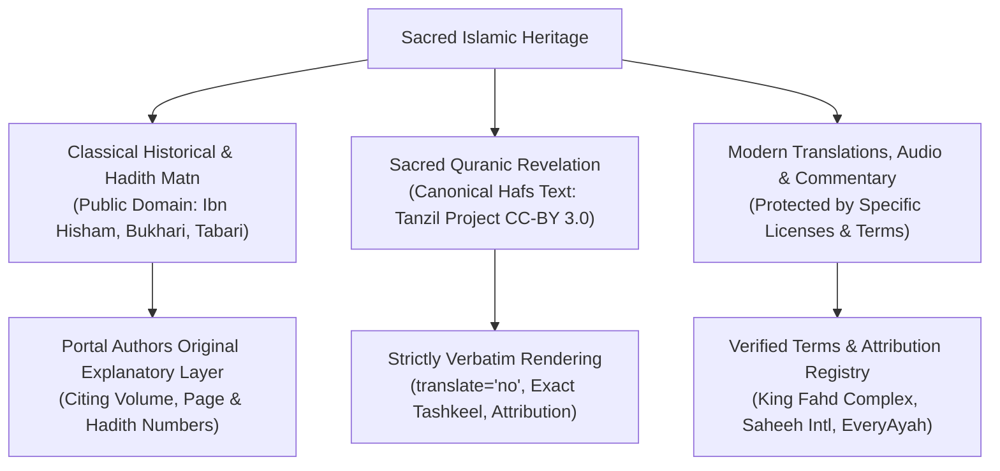

# Copyright, Licensing & Source Provenance Register

**Document Reference:** `AUDIT/CONTENT-QUALITY-AND-LOCALIZATION/COPYRIGHT-AND-SOURCE-REGISTER.md`  
**JSON Machine-Readable Registry:** [`data/content-rights-registry.json`](file:///e:/islamic%20websiye/data/content-rights-registry.json)  
**Workspace:** `E:\islamic websiye`  
**Date of Verification:** October 2026  
**Auditor:** Content Rights, Provenance & Legal Compliance Specialist  

---

## 1. Principles of Legal and Religious Intellectual Property

A common error in digital Islamic projects is the assumption that because religious texts and Islamic history belong to the spiritual heritage of all Muslims, all modern digital materials, translations, commentaries, databases, and audio recordings are in the public domain.

This portal adheres to strict legal, ethical, and religious distinctions:

1. **Original Arabic Scripture & Classical Matn**:
   - The classical Arabic text of the Holy Quran, Hadith collections (Bukhari, Muslim, Abu Dawud, Tirmidhi, Nasa'i, Ibn Majah), and ancient historiography (Ibn Hisham, al-Tabari, Ibn Sa'd) are ancient public domain heritage.
   - However, digital typographic encodings (e.g. Tanzil Project's Hafs text) are licensed under specific conditions (CC-BY 3.0) requiring verbatim preservation and source attribution.
2. **Modern Translations**:
   - Modern translations (e.g., Saheeh International, Dr. Muhammad Hamidullah, Kemenag Indonesia, Diyanet Turkey) are protected by copyright. They are used under explicit Open Access Islamic educational distribution terms or public government waqf licenses.
3. **Original Explanatory Layer**:
   - The portal's detailed Seerah chapters, Sahaba biographies, historical era analyses, and worship guides are **original compositions**. They synthesize primary facts from classical sources in the portal's own words and pedagogical structure, with exact citations, rather than copying modern copyrighted books.

---

## 2. Key Dataset Licensing Compliance

### 2.1 Tanzil Quranic Text Compliance
- **Source**: Tanzil Project (`https://tanzil.net/download/`)
- **License**: Creative Commons Attribution 3.0 Unported (CC-BY 3.0).
- **Mandatory Terms**:
  1. *Verbatim Text*: The stored Arabic text of the 6,236 Ayahs must remain completely unchanged.
  2. *Attribution*: Tanzil.net must be credited with an active hyperlink.
  3. *Copyright Notice*: Tanzil copyright notice must be preserved.
- **Verification**: Verified. In `public/js/quran.js`, Tanzil is credited, and Arabic Ayahs are rendered with `translate="no"` to prevent browser modifications.

### 2.2 Quran Translations (QuranEnc & King Fahd Complex)
- **Source**: QuranEnc (`https://quranenc.com/`) and King Fahd Glorious Quran Printing Complex.
- **Verification**: The 40 translations registered in `data/quran-translations/registry.json` correspond to verified editions:
  - English: Saheeh International (`en.sahih`)
  - Urdu: Maulana Fateh Muhammad Jalandhari (`ur.jalandhry`, Public Domain)
  - Arabic Commentary: Al-Tafsir al-Muyassar (`ar.muyassar`, King Fahd Complex Waqf)
  - French: Dr. Muhammad Hamidullah (`fr.hamidullah`)
  - Indonesian: Kementerian Agama RI (`id.kemenag`)
  - Turkish: Diyanet İşleri Başkanlığı (`tr.diyanet`)
- **Attribution**: Displayed dynamically in the Quran Reader toolbar and when copying or sharing Ayahs.

### 2.3 Audio Recitations (EveryAyah.com)
- **Source**: EveryAyah.com repository.
- **License**: Permissive non-commercial Islamic educational streaming.
- **Constraint**: Recitations are streamed on-demand over HTTPS to preserve lightweight download footprints ($<1\text{ MB}$ base bundle) rather than pre-packaging 1.8 GB of audio into APK distributions.

---

## 3. Comprehensive Content Rights Inventory

The table below reflects the machine-readable records stored in [`data/content-rights-registry.json`](file:///e:/islamic%20websiye/data/content-rights-registry.json):

| Content ID | Content Type | Title | Creator / Publisher | License & Version | Offline APK? | Attribution Requirement |
| :--- | :--- | :--- | :--- | :--- | :--- | :--- |
| `CR-QUR-001` | Quran Scripture | Tanzil Uthmani Hafs (6,236 Ayahs) | Tanzil Project (H. Zarrabi-Zadeh) | CC-BY 3.0 Unported | **Yes** | Tanzil.net credit with link |
| `CR-TRN-EN01` | Quran Translation | Saheeh International | Saheeh International / King Fahd | Open Access Educational | **Yes** | Saheeh International, Riyadh |
| `CR-TRN-UR01` | Quran Translation | Fateh Muhammad Jalandhari | Maulana F. M. Jalandhari | Public Domain (Classical) | **Yes** | Fateh Muhammad Jalandhari |
| `CR-TRN-AR01` | Quran Tafsir | Al-Tafsir al-Muyassar | King Fahd Complex Committee | Open Access Official Waqf | **Yes** | King Fahd Glorious Quran Complex |
| `CR-TRN-FR01` | Quran Translation | Traduction Française du Coran | Dr. Muhammad Hamidullah | Open Access Educational | **Yes** | Dr. Muhammad Hamidullah |
| `CR-TRN-ID01` | Quran Translation | Al-Qur'an dan Terjemahannya | Kemenag RI / LPMQ | Open Access Government | **Yes** | Kementerian Agama RI |
| `CR-TRN-TR01` | Quran Translation | Kur'an-ı Kerim Meali | Diyanet İşleri Başkanlığı | Open Access Religious Auth | **Yes** | Diyanet İşleri Başkanlığı |
| `CR-HAD-BUK` | Hadith Corpus | Sahih al-Bukhari | Imam al-Bukhari (194–256 AH) | Public Domain (Classical Matn) | **Yes** | Collection name & Hadith # |
| `CR-HAD-MUS` | Hadith Corpus | Sahih Muslim | Imam Muslim (206–261 AH) | Public Domain (Classical Matn) | **Yes** | Collection name & Hadith # |
| `CR-DUA-HIS` | Du'a Collection | Hisn al-Muslim | Shaykh Sa'id ibn Wahf al-Qahtani | Permissive Educational Waqf | **Yes** | Sa'id al-Qahtani collection credit |
| `CR-SEE-HSH` | Historiography | Al-Sirah al-Nabawiyyah | Ibn Hisham (d. 218 AH) | Public Domain (Ancient Text) | **Yes** | Primary source reference |
| `CR-SEE-SAD` | Biography | Kitab al-Tabaqat al-Kabir | Ibn Sa'd (168–230 AH) | Public Domain (Ancient Text) | **Yes** | Primary source reference |
| `CR-SAH-ASQ` | Prosopography | Al-Isabah fi Tamyiz al-Sahabah | Ibn Hajar al-Asqalani (d. 852 AH) | Public Domain (Ancient Text) | **Yes** | Primary source reference |
| `CR-HIS-TAB` | Universal History | Tarikh al-Rusul wal-Muluk | At-Tabari (224–310 AH) | Public Domain (Ancient Text) | **Yes** | Primary source reference |
| `CR-AUD-AFY` | Audio Recitation | Mishary Rashid Alafasy Recitation | EveryAyah.com / Qari Alafasy | Permissive Educational Stream | **No (Stream)** | Qari Alafasy / EveryAyah |
| `CR-AST-PRY` | Astronomical Math | Solar Prayer Times Algorithm | PrayTimes.org (H. Zarrabi-Zadeh) | GNU LGPL v3.0 / Math Eqs | **Yes** | PrayTimes.org algorithm credit |

---

## 4. Quarantined & Forbidden Practices

1. **Automated Machine-Translation of Religious Fiqh/Hadith**:
   - Machine translation APIs (Google Translate, DeepL) are prohibited from directly publishing unreviewed Arabic/English fiqh or Hadith into secondary languages, due to high error rates on nuanced terms (*Shirk*, *Ismah*, *Wajib*, *Makruh*).
2. **Wholesale Scraping of Modern Copyrighted Treatises**:
   - Extracting entire chapters from modern copyrighted authors without written authorization is strictly prohibited. The portal relies on its own synthesis of classical public domain works.
3. **Uncredited Data Redistribution**:
   - All copied or shared verses dynamically append translator and collection attribution.
