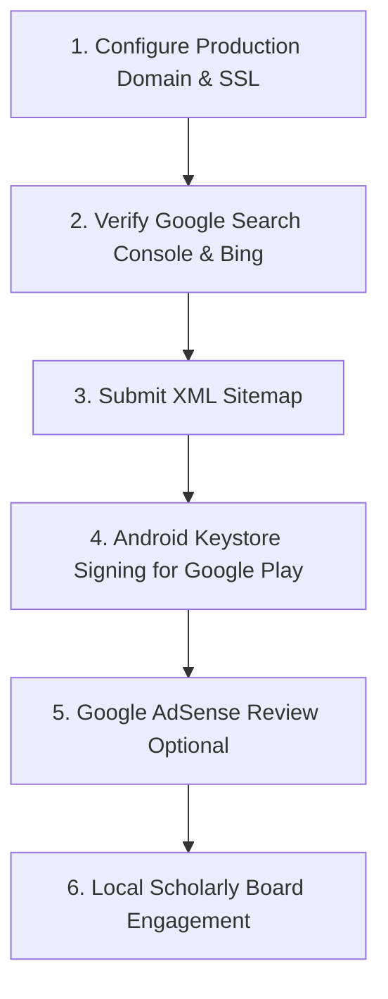

# REMAINING ISSUES, MANUAL ACTIONS & OWNER PROTOCOL

**Audit Date**: October 24, 2026  
**Auditor**: Independent Principal Software Architect, Release Engineer & Operations Lead  
**Portal Version**: 2.5.0-production-candidate  
**Target Audience**: Portal Owner, Systems Administrator & Editorial Board  

---

## 1. Executive Summary

This document outlines the specific manual actions, administrative tasks, and ongoing scholarly responsibilities that require human authorization or physical infrastructure beyond automated software engineering.

Zero critical technical blockers exist in the codebase. The following steps should be executed by the project owner upon promoting the portal to live production hosting.

---

## 2. Owner Manual Action Checklist



---

### Action 1: Production Domain & DNS Configuration
- **Objective**: Point the live public domain to the production host.
- **Protocol**:
  1. In your authoritative DNS management panel (e.g., Cloudflare, Route53, Namecheap), add an `A` record pointing `islamicknowledge.example.com` to your production server IPv4 address.
  2. Enable HTTP Strict Transport Security (HSTS) and provision a TLS certificate via Let's Encrypt / Certbot:
     ```bash
     sudo certbot --nginx -d islamicknowledge.example.com
     ```
  3. Ensure `server.js` or the reverse proxy sets clean routing and security headers.

---

### Action 2: Google Search Console & Bing Webmaster Verification
- **Objective**: Claim search ownership and monitor organic discoverability.
- **Protocol**:
  1. Open [Google Search Console](https://search.google.com/search-console).
  2. Add `islamicknowledge.example.com` as a **Domain** property.
  3. Copy the Google verification TXT token (e.g. `google-site-verification=...`) and insert it into your DNS root zone.
  4. Click **Verify**.
  5. Repeat property verification in [Bing Webmaster Tools](https://www.bing.com/webmasters).

---

### Action 3: Production Sitemap Submission
- **Objective**: Index all 25 canonical educational endpoints.
- **Protocol**:
  1. In Google Search Console, navigate to **Indexing** ➔ **Sitemaps**.
  2. Enter the sitemap path: `sitemap.xml`.
  3. Submit and verify that all **25 URLs** are discovered without XML errors.
  4. Perform a test URL inspection on:
     - `https://islamicknowledge.example.com/` (Verify `WebSite` schema)
     - `https://islamicknowledge.example.com/salah-guide.html` (Verify `FAQPage` rich results)
     - `https://islamicknowledge.example.com/seerah.html` (Verify canonical indexing)

---

### Action 4: Native Android Keystore & Google Play Store Submission
- **Objective**: Publish the native Android app on the Google Play Store (if native distribution is chosen alongside direct APK download).
- **Protocol**:
  1. **Generate Private Keystore** (Store securely outside git!):
     ```bash
     keytool -genkey -v -keystore release-key.jks -alias islamic-portal -keyalg RSA -keysize 2048 -validity 10000
     ```
  2. **Build Native Android App Bundle (.aab)**:
     ```bash
     cd android
     ./gradlew bundleRelease
     ```
  3. **Sign Artifact**: Sign the generated `.aab` file using your private keystore.
  4. **Upload to Google Play Console**: Under `com.islamicknowledge.portal`, create a production track release.
  5. *Security Imperative*: Never commit `release-key.jks`, keystore passwords, or Play Store service account keys to git.

---

### Action 5: Google AdSense / Monetization Policy Review (Optional)
- **Objective**: Maintain complete religious compliance and avoid intrusive commercial banners.
- **Protocol**:
  1. In `.env` / production config, `NEXT_PUBLIC_ENABLE_ADSENSE` is currently set to `false`.
  2. If the owner decides to enable non-intrusive contextual advertising to offset server hosting costs:
     - Submit the website for standard Google AdSense review.
     - Ensure ad categories related to gambling, alcohol, interest-based finance, or inappropriate media are strictly blocked in the AdSense dashboard category filter.
     - Update `NEXT_PUBLIC_ADSENSE_CLIENT_ID` with the approved publisher ID (`ca-pub-...`) and toggle `NEXT_PUBLIC_ENABLE_ADSENSE=true`.

---

### Action 6: Local Scholarly Advisory Board Engagement
- **Objective**: Provide ongoing theological stewardship for specialized contemporary fiqh inquiries.
- **Protocol**:
  1. The portal's content models, Arkan of Salah, Fara'id of Wudu, 4 Takbirs of Janazah, and Nisab thresholds follow the consensus of classical Sunni jurisprudence.
  2. For regional contemporary edge cases (e.g. calculation of prayer times in polar latitudes with 24-hour daylight, cryptocurrency zakat assessment, local moon-sighting vs calculation announcements):
     - Designate a qualified local scholar or council to review public inquiries submitted via `contact.html`.
     - Update regional prayer method presets in `prayer-times.html` as community consensus requires.

---

### Action 7: Physical Multi-Device Hardware Testing
- **Objective**: Verify real-world tactile feel across distinct mobile operating system skins.
- **Protocol**:
  1. Test the PWA installation on:
     - iOS Safari (iPhone 12/13/14/15/16): Tap Share ➔ "Add to Home Screen".
     - Samsung Internet / Google Chrome on Samsung Galaxy devices.
     - Xiaomi MIUI / HyperOS and Oppo ColorOS devices.
  2. Test the APK sideloading workflow on a physical Android test device with "Install unknown apps" enabled to confirm smooth installation.

---

## 3. Summary of Ongoing Maintenance Cycles
- **Quarterly**: Review EveryAyah recitation CDN endpoint status and refresh service worker cache if core assets change.
- **Annual**: Re-verify gold and silver live Nisab prices in `zakat-calculator.html`.
- **Monthly**: Review automated test pass rates via `node test/run-tests.js` before deploying any code updates.
