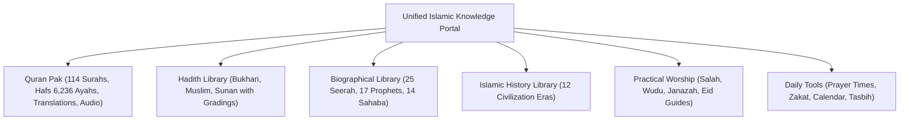

# PHASE 12H — COMPETITIVE POSITIONING AND STRATEGIC OPPORTUNITIES

**Audit Date:** October 24, 2026  
**Auditor:** Principal Software Architect & Product Strategist  
**Focus:** Unique Value Proposition (UVP), Strategic Differentiators, and Features Explicitly Excluded from Scope  

---

## 1. Our Core Competitive Advantage

Most established Islamic platforms excel in a single vertical:
- **Quran.com** is strictly focused on the text and recitation of the Quran.
- **Sunnah.com** is strictly focused on archiving Hadith collections.
- **IslamQA.info / IslamQA.org** are focused on legal questions and answers (*fatawa*).
- **Yaqeen Institute** is focused on academic research papers.
- **IslamicFinder** is focused on prayer times and daily utilities.

**Our Portal's Distinctive Position:**  
The **Islamic Knowledge Portal** is engineered as a **Single, Unified, Cohesive Learning Ecosystem** that bridges the gap between sacred scripture, prophetic traditions, historical narratives, practical worship, and daily astronomical tools.

---

## 2. Top Strategic Differentiators

1. **Contextual Cross-Linking Between Quran, Hadith & Seerah:**  
   When a user reads the Seerah of the Prophet ﷺ (e.g. the Battle of Badr or Treaty of Hudaybiyyah), the narrative directly links to the relevant Quranic Ayahs (Surah Al-Anfal, Surah Al-Fath) and authentic Hadith traditions.
2. **South Asian & Global Diaspora Localization:**  
   Our search engine features a specialized **phonetic normalizer** that effortlessly parses Roman Urdu, Arabic variations, and common phonetic spellings (e.g., `bakra` $\rightarrow$ Surah Al-Baqarah, `fatiha` $\rightarrow$ Surah Al-Fatihah, `kursi` $\rightarrow$ Ayatul Kursi).
3. **True Offline Independence & Direct APK Distribution:**  
   Unlike web-only competitors or heavy native apps requiring continuous cloud connectivity, our entire portal operates offline via Service Worker caching, downloadable ZIP bundles, and a standalone Android APK (under 1 MB).
4. **Zero-Tracking Privacy Guarantee:**  
   No invasive analytics, no third-party behavioral profiling, and no account creation barriers. User bookmarks and reading positions reside strictly on the user's device.
5. **Multi-Madhhab Respectful Fiqh Presentation:**  
   Our worship guides present the consensus (*ittifaq*) of the major Sunni schools of jurisprudence alongside respectful notation of madhhab differences (Hanafi, Shafi'i, Maliki, Hanbali), avoiding sectarian polarization.

---

## 3. Features Deliberately EXCLUDED (What NOT to Copy)

To protect the portal's integrity, performance, and maintainability, the following competitor features are deliberately rejected:

| Competitor Feature | Relevant Competitor | Reason for Explicit Rejection |
|---|---|---|
| **Live Interactive Fatwa Desk** | IslamQA.info / IslamQA.org | Issuing personalized religious rulings (*fatawa*) requires a certified, around-the-clock board of authorized Muftis. An educational portal must clearly distinguish between publishing verified academic resources and issuing personal legal rulings. |
| **User Comments & Discussion Forums** | Various blogs / community apps | Religious discussion sections quickly degenerate into unmoderated sectarian arguments, misinformation, and spam, requiring substantial moderation overhead. |
| **Heavy Single Page App Frameworks** | React / Angular / Next.js portals | Migrating to heavy client frameworks would bloat download size, introduce hydration lag, degrade performance on budget mobile devices, and increase APK size from 140 KB to 40+ MB. |
| **Mandatory User Registration & Social Login** | Various course platforms | Religious knowledge should be accessible freely without forcing users to surrender personal emails or social credentials ("Knowledge Without Barriers"). |
| **Automated AI Fatwa Generation** | Unverified modern AI tools | Utilizing unvetted generative AI to formulate novel religious rulings without human scholarly oversight violates Islamic data integrity standards. |
