# Phase 13 Audit: After-Redesign Empirical Results & Comparison

**Document Reference:** `AUDIT/PHASE-13/AFTER-REDESIGN-RESULTS.md`  
**Phase:** 13 of 13 — Real Product Redesign, Global Content Localization & Quality Transformation  
**Status:** Complete  
**Date:** October 2026  

---

## 1. Before vs After Comparative Matrix

```mermaid
flowchart LR
    subgraph Before ["PRE-PHASE 13 STATE"]
        B1["Visual Clutter & Competing CTAs"]
        B2["Language Claims: Ambiguous 40-lang claims with 3-lang UI cap"]
        B3["Reading UX: Missing translation status banners"]
        B4["Arabic Text: Risk of machine translation corruption"]
        B5["Test Coverage: 931 tests, 30 suites"]
    end

    subgraph After ["PHASE 13 REDESIGNED STATE"]
        A1["Dignified Classical Design: Calm 8-pillar hub & balanced daily cards"]
        A2["Honest Tiered Architecture: 11 verified UI + 40 Quran translations"]
        A3["Scholarly Status Banners across all reading libraries"]
        A4["Inviolable Immutability: translate='no' & hard attribute guards"]
        A5["Test Coverage: 965 passing tests across 31 comprehensive suites"]
    end

    Before ==> After
```

| Dimension | Pre-Phase 13 Baseline | Phase 13 Redesigned State | Evaluation |
| :--- | :--- | :--- | :--- |
| **Visual Aesthetics & Calm** | Busy bento grid, competing neon badges, harsh button contrasts | Serene Deep Jade (`#0F5132`), Warm Ivory background, classical Islamic proportion | **Vastly Superior** |
| **Homepage Navigation** | Scattered links, redundant buttons | Clear Hero with search trigger (`Ctrl+K`) + 6 quick pills; 8-Pillar Knowledge Gateway | **Streamlined & Intuitive** |
| **Spiritual vs Astro Balance** | Disjointed prayer times widget separated from daily verse | Balanced 2-column `.daily-foundations-grid`: Today's Sacred Verse side-by-side with Solar Observatory | **Balanced & Elegant** |
| **Language Selection** | UI arbitrarily locked to 3 languages despite 11 dictionaries existing | Expanded to all 11 verified languages with native script names, RTL/LTR badges, and 40-lang Quran notice | **Truthful & Inclusive** |
| **Content Translation Status** | Users confused why educational articles were in English/Urdu | Explicit `.content-lang-banner` on Seerah, Prophets, Sahaba, History, Salah | **Transparent & Scholarly** |
| **Sacred Arabic Protection** | Implicit assumptions in rendering | Explicit `translate="no"`, `dir="rtl"`, and `lang="ar"` on Quran, Kalimas, and Duas | **Hardened & Immutable** |
| **Automated Test Quality** | 931 tests across 30 suites | **965 tests across 31 suites (100% passing)** | **+34 New Strict Assertions** |

---

## 2. Quantitative Verification Metrics

- **Automated Tests Executed**: 965 tests.
- **Automated Tests Passed**: 965 tests ($100.0\%$).
- **Failing Tests**: 0.
- **Internal Broken Links (Suite 12)**: 0 broken links across 1,053 crawled internal links.
- **HTML Pages Validated**: 24 pages.
- **Canonical Meta Tags**: Present on 24 / 24 pages.
- **Open Graph & Twitter Cards**: Present on 24 / 24 pages.
- **PWA Manifest Linked**: Present on 24 / 24 pages.
- **Canonical Quranic Verses**: Exactly 6,236 Ayahs.
- **Canonical Quranic Surahs**: Exactly 114 Surahs.

---

## 3. Resolution of Owner Dissatisfaction Points

1. **"The design feels cheap, cluttered, and not like a true sacred library"**:
   - Resolved by implementing the Deep Jade, Warm Ivory, and Muted Brass design system, removing visual noise, and elevating typography with high-contrast, classical proportions.
2. **"People in other countries cannot understand what is available"**:
   - Resolved by opening the UI to 11 verified global languages, providing native script labels, and displaying explicit status banners explaining translation availability.
3. **"Arabic Quran text might get distorted when switching languages"**:
   - Resolved by enforcing `translate="no"`, `dir="rtl"`, and `lang="ar"` on all sacred Arabic text, and architecturally decoupling the 40 Quran translations from the UI translation engine.
4. **"The mobile layout shakes horizontally"**:
   - Resolved by enforcing `overflow-x: hidden` and strict viewport bounds, verified across budget Android ($360\text{px}$) to flagship desktop ($1920\text{px}$).
