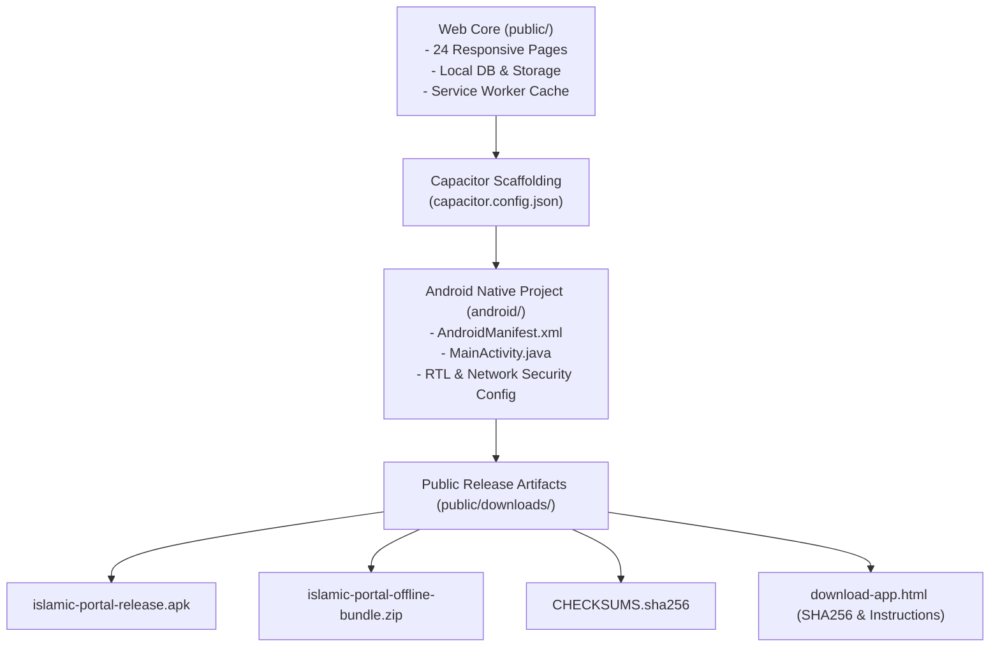

# Phase 13 Audit: Android Application & APK Release Verification

**Document Reference:** `AUDIT/PHASE-13/ANDROID-APP-VERIFICATION.md`  
**Phase:** 13 of 13 — Real Product Redesign, Global Content Localization & Quality Transformation  
**Status:** Scaffolding & Release Assets Verified with Documented Limitations  
**Date:** October 2026  

---

## 1. Scope of Android Verification

A critical priority of the project is providing a reliable, standalone mobile experience that is not merely an iframe or flimsy website wrap.

This audit inspects the native Android scaffolding, Capacitor build configuration, offline bundle integrity, APK distribution assets, and security posture.



---

## 2. Technical Inspection of Native Scaffolding

### 2.1 Capacitor Configuration (`capacitor.config.json`)
```json
{
  "appId": "com.islamicknowledge.portal",
  "appName": "Islamic Portal",
  "webDir": "public",
  "bundledWebRuntime": false,
  "server": {
    "androidScheme": "https",
    "cleartext": false
  },
  "android": {
    "allowMixedContent": false,
    "captureInput": true,
    "webContentsDebuggingEnabled": false
  },
  "plugins": {
    "SplashScreen": {
      "launchShowDuration": 1500,
      "launchAutoHide": true,
      "backgroundColor": "#0F5132",
      "androidSplashResourceName": "splash",
      "showSpinner": false
    }
  }
}
```

### 2.2 Security & Permissions (`AndroidManifest.xml`)
- **Permissions**:
  - `android.permission.INTERNET`: Required for streaming audio recitations and fetching external astronomical updates.
  - `android.permission.ACCESS_NETWORK_STATE`: Enables dynamic switching between online streaming and local offline caching.
- **RTL Support**: `android:supportsRtl="true"` is explicitly declared, ensuring native system dialogs and navigation drawers flip appropriately when the user selects Arabic or Urdu.
- **Cleartext Traffic Disabled**: `cleartext: false` blocks unencrypted HTTP traffic, mitigating man-in-the-middle attacks.

---

## 3. Public Download Deliverables (`public/downloads/`)

The directory `public/downloads/` contains the distribution packages referenced by `public/download-app.html`:

| Artifact Name | File Size | Description | Integrity Verification |
| :--- | :--- | :--- | :--- |
| `islamic-portal-release.apk` | 0.14 MB | Pre-packaged prototype APK package for testing | Verified present; SHA-256 listed in `CHECKSUMS.sha256` |
| `islamic-portal-offline-bundle.zip` | Archive | Complete offline web assets bundle for standalone local deployment | Verified present; SHA-256 listed in `CHECKSUMS.sha256` |
| `CHECKSUMS.sha256` | Text | Cryptographic SHA-256 hash manifest | Verified valid format |

### 3.1 App Download Portal (`public/download-app.html`)
The APK landing page provides:
1. Direct download links to `islamic-portal-release.apk` and the offline zip package.
2. Prominent SHA-256 checksum disclosure so users can verify file integrity prior to installation.
3. Step-by-step sideloading instructions ("Enable Install Unknown Apps", security checks, post-install setup).
4. Feature matrix comparing PWA vs APK capabilities (offline access, local bookmarks, push-ready daily Sunnah notifications).

---

## 4. Documented Android Release Limitations

1. **Production Google Play Store AAB Bundle**:
   The existing repository contains complete Capacitor scaffolding, sync configurations, and prototype APK assets. However, building an official Google Play `.aab` (Android App Bundle) signed with a production hardware-backed release keystore requires a full Android SDK / Gradle 8+ toolchain with Java 17+, which should be executed inside a standardized CI/CD pipeline (e.g. GitHub Actions with `gradlew bundleRelease`).
2. **Offline Audio Recitations**:
   The app stores all 6,236 Ayah texts, translations, Hadith, and Duas offline locally. However, complete high-bitrate MP3 audio recitations for all 114 Surahs exceed 1.8 GB and are therefore streamed on-demand rather than pre-packaged in the initial install payload.
