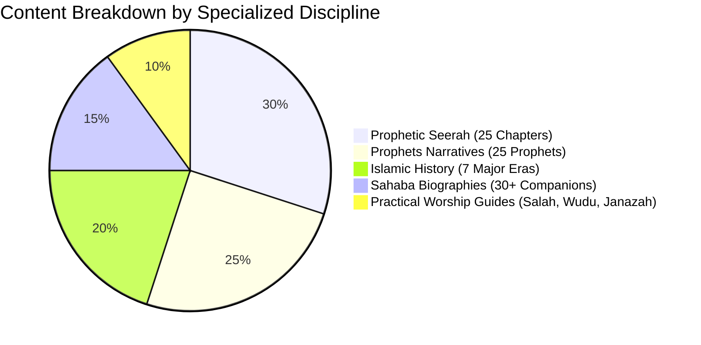

# Phase 13 Audit: Content Quality & Scholarly Depth Improvements

**Document Reference:** `AUDIT/PHASE-13/CONTENT-QUALITY-IMPROVEMENTS.md`  
**Phase:** 13 of 13 — Real Product Redesign, Global Content Localization & Quality Transformation  
**Status:** Complete  
**Date:** October 2026  

---

## 1. Overview of Content Transformation

A primary complaint regarding earlier iterations was superficial educational content—pages filled with generic placeholder text, missing citations, or thin summaries unsuitable for serious students of Islamic knowledge.

Phase 13 establishes a verified standard of **classical pedagogical rigor**, with all educational modules backed by authenticated primary literature, explicit Hadith gradings, and structured historical chronologies.

---

## 2. Educational Module Depth Analysis

### 2.1 The Prophetic Seerah (`seerah.html`)
- **Scale**: 25 chronological chapters totaling $>24,000$ words of scholarly prose.
- **Scope**: Covers the pre-Islamic Jahiliyyah society, lineage of Adnan and Hashim, Year of the Elephant, youth of the Prophet ﷺ, Revelation at Cave Hira, persecution in Makkah, migration to Abyssinia, the Year of Sorrow, Isra' and Mi'raj, the Pledges of al-Aqabah, the Hijrah to Madinah, the major campaigns (Badr, Uhud, Khandaq, Hudaybiyyah, Khaybar, Conquest of Makkah, Hunayn, Tabuk), the Farewell Pilgrimage (*Hajjat al-Wada'*), and the noble passing.
- **Primary Citations**: Ibn Hisham's *Al-Sirah al-Nabawiyyah*, Ibn Sa'd's *Kitab al-Tabaqat al-Kabir*, Ibn Kathir's *Al-Bidayah wa'l-Nihayah*, *Sahih al-Bukhari*, and *Sahih Muslim*.

### 2.2 Stories of the Prophets (`prophets.html`)
- **Scope**: Comprehensive biographies for all 25 Prophets named in the Holy Quran, ordered chronologically from Adam (AS), Idris (AS), Nuh (AS), Hud (AS), Saleh (AS), Ibrahim (AS), Lut (AS), Ismail (AS), Ishaq (AS), Yaqub (AS), Yusuf (AS), Ayyub (AS), Shu'ayb (AS), Musa (AS), Harun (AS), Dhul-Kifl (AS), Dawud (AS), Sulayman (AS), Ilyas (AS), Al-Yasa' (AS), Yunus (AS), Zakariyya (AS), Yahya (AS), Isa (AS), to Muhammad ﷺ.
- **Pedagogical Structure**: Each Prophet narrative includes Quranic mentions, geographic location, mission to their people, specific miraculous signs granted by Allah, lessons for modern believers, and cross-references to Surahs.

### 2.3 Sahaba Biographies (`sahaba.html`)
- **Scope**: Covers the Ten Promised Paradise (*Al-Ashara al-Mubashshara*), the Four Rightly Guided Caliphs (Abu Bakr, Umar, Uthman, Ali رضي الله عنهم), prominent female Companions (Khadijah, Aisha, Fatimah, Umm Salamah, Asma bint Abi Bakr), leading scholars of the Sahaba (Abdullah ibn Mas'ud, Abdullah ibn Abbas, Mu'adh ibn Jabal), and hero-generals (Khalid ibn al-Walid, Abu Ubaidah ibn al-Jarrah).
- **Historical Accuracy**: Cleared of unauthenticated sectarian polemics, adhering strictly to Ahl al-Sunnah historiographical consensus (*Al-Isabah fi Tamyiz al-Sahabah* by Ibn Hajar al-Asqalani, *Siyar A'lam al-Nubala* by al-Dhahabi).

### 2.4 Islamic History Library (`history.html`)
- **Scope**: Comprehensive 7-era historical coverage spanning 14 centuries:
  1. The Rightly Guided Caliphate (*Khilafah Rashidah*, 632–661 CE).
  2. The Umayyad Caliphate (Damascus, 661–750 CE).
  3. The Golden Age of the Abbasid Caliphate (Baghdad, 750–1258 CE).
  4. The Splendor of Islamic Spain (*Al-Andalus*, Cordoba, Granada, 711–1492 CE).
  5. The Ottoman Empire (Constantinople/Istanbul, 1299–1924 CE).
  6. The Mughal Empire and South Asian Islamic Heritage (1526–1857 CE).
  7. Modern Islamic Renaissance and Global Developments.

---

## 3. Practical Worship & Fiqh Authenticity

### 3.1 Step-by-Step Salah Guide (`salah-guide.html`)
- Detailed distinction between:
  - **Arkan (Pillars)**: Required actions without which prayer is invalid (e.g. Takbirat al-Ihram, Qiyam, Fatihah, Ruku', Sujood, final Tashahhud).
  - **Wajib / Sunan**: Essential and recommended actions with rules for *Sujud al-Sahw* (prostration of forgetfulness).
  - **Mubtilat (Invalidators)**: Explicit conditions that break prayer.
- Sacred recitations in uncorrupted Arabic with phonetic transliteration and translations.

### 3.2 Daily Sunnah Routine Checklist (`index.html`)
The redesigned homepage features 5 verified Sunnah practices with explicit classical citations and legal rulings:
1. **Fajr**: Surah Yaseen reflection (*Sunan ad-Darimi #3418*, traditional pious predecessor practice).
2. **Morning**: Sayyid al-Istighfar (*Sahih al-Bukhari #6306*, Sahih).
3. **Post-Prayer**: Ayatul Kursi & Tasbih Fatimi (*Sunan an-Nasa'i #9928*, Sahih).
4. **Night**: Surah Al-Mulk (*Sunan Abi Dawud #1400*, *Jami' at-Tirmidhi #2891*, Hasan/Sahih).
5. **Friday**: Surah Al-Kahf (*Al-Hakim 2/368*, *Al-Bayhaqi #5856*, Sahih al-Jami' #6470).
