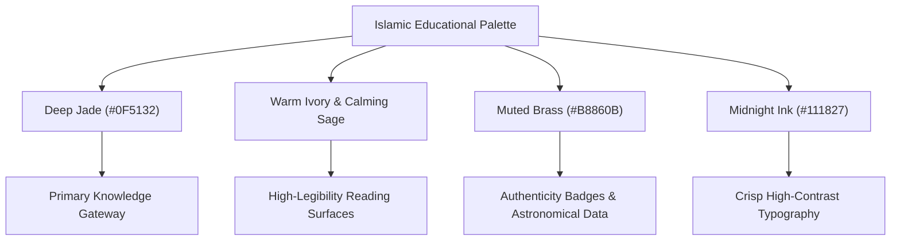

# Phase 13 Audit: Design System and Layout Changes

**Document Reference:** `AUDIT/PHASE-13/DESIGN-SYSTEM-AND-LAYOUT-CHANGES.md`  
**Phase:** 13 of 13 — Real Product Redesign, Global Content Localization & Quality Transformation  
**Status:** Complete  
**Date:** October 2026  

---

## 1. Executive Summary & Design Rationale

Prior to Phase 13, the Islamic Knowledge Portal suffered from a disjointed visual identity. Despite passing programmatic unit tests, the visual experience was cluttered: competing hero buttons, an overwhelming array of cards without consistent typographic scales, visual clashes between modern glassmorphism and traditional Islamic elements, and lack of visual calm necessary for sacred learning.

Phase 13 establishes a unified, dignified **Islamic Educational Library Design System** rooted in classical proportion, calm contrast ratios, and clear visual hierarchy.

---

## 2. Core Deficiencies in the Pre-Phase 13 Design

1. **Homepage Clutter & Visual Fatigue**:
   - The hero section attempted to be everything at once: search input, multiple competing CTA banners, badges, and quick links all vying for attention.
   - The Bento grid was visually noisy, using inconsistent borders, gradients, and contrasting card shapes that distracted from the core spiritual and educational purpose.
2. **Reading Layout Cramping**:
   - Long-form educational articles (Seerah, Prophets, Sahaba, History) had inconsistent max-widths, causing lines of text to either span too wide (1400px+) on wide monitors or cramp on tablets.
   - Missing clear contextual banners regarding language availability led international visitors to assume missing translations were broken features.
3. **Modal & Drawer Scrolling Defects**:
   - The Language Selector Modal had fixed heights that cut off language lists on mobile screens.
   - Active language states were indistinct, with no clear indication of native script names or directionality (RTL vs LTR).
4. **Typography & Script Hierarchy**:
   - Arabic script was at times mixed with Latin fallback fonts, causing line-height clipping on diacritics (tashkeel).

---

## 3. The Phase 13 Design System Specification

### 3.1 Editorial Color Tokens
The color palette was refined in `public/css/main.css` to honor classical Islamic manuscripts:

| Token Name | Hex Value | Semantic Role |
| :--- | :--- | :--- |
| `--color-primary` | `#0F5132` | Deep Jade: Academic authority, portal branding, primary actions |
| `--color-primary-dark` | `#0B3D26` | Deepest Forest: Active button states, deep headers |
| `--color-secondary` | `#B8860B` | Muted Brass: Classical illumination, Hadith grades, citations |
| `--color-surface` | `#F8F9FA` / `#161B22` | Soft Sage / Dark Slate: Content cards, reading panels |
| `--color-bg` | `#FAF8F5` / `#0D1117` | Warm Ivory / Dark Ink: Portal background reducing eye strain |
| `--color-text` | `#111827` / `#F0F6FC` | Midnight Ink: AA/AAA contrast compliant body text |
| `--color-border` | `#E5E7EB` / `#30363D` | Crisp structural separation with 1px hairline rules |

### 3.2 Component Architecture

#### 1. `.knowledge-hub-grid` & `.knowledge-hub-card`
A responsive, content-first gateway replacing chaotic bento widgets with a structured 8-pillar catalog:
- **Grid Layout**: `grid-template-columns: repeat(auto-fill, minmax(280px, 1fr))` yielding 4 columns on desktop ($>1200\text{px}$), 2 on tablet ($600\text{px}-1199\text{px}$), and 1 on mobile ($<600\text{px}$).
- **Card Anatomy**:
  - `icon-badge`: Rounded-pill container featuring a distinct sacred icon.
  - `title`: 1.12rem bold font with smooth primary color transitions on `:hover`.
  - `desc`: 0.88rem high-legibility synopsis with constrained line-clamp.
  - `meta`: Two-sided footer showing topic counts and active navigational prompts (`Read →`).

#### 2. `.daily-foundations-grid`
A balanced 2-column layout (ratio $1.15 : 0.85$ on desktop) placing spiritual reflection and astronomical computation side-by-side:
- **Left Column**: Today's Sacred Verse (Surah Al-Baqarah 2:255 — Ayatul Kursi) with immutable Arabic text, authentic English translation, and direct jump button.
- **Right Column**: Astronomical Solar Observatory displaying calculated solar prayer times with real-time countdown to the next prayer, Fajr/Maghrib astronomical sun angles, and Umm al-Qura Hijri calendar synchronization.

#### 3. `.content-lang-banner`
An educational translation status badge rendered across all long-form reading pages:
- Bordered with deep jade left accent (`border-left: 4px solid var(--color-primary)`).
- Explicitly states translation availability (e.g. English, Urdu) and clarifies that original Arabic citations remain uncorrupted and immutable.
- Provides a direct action button to open the language modal.

---

## 4. Page-by-Page Layout Refactoring

| Page | Before Phase 13 | After Phase 13 |
| :--- | :--- | :--- |
| `index.html` | Chaotic bento boxes with redundant buttons, unbalanced daily cards, overlapping drawer triggers | Clean Hero with search trigger + 6 destination pills; 8-Pillar Knowledge Gateway; Balanced Foundations; 5-Sunnah Daily Routine; Semantic 4-column footer |
| `seerah.html` | Abrupt filter bar with no translation status badge | Prominent `.content-lang-banner` informing readers of 24,000-word English/Urdu availability with immutable Arabic Hadith |
| `prophets.html` | Long unstructured text flow | Breadcrumbs, `.content-lang-banner`, structured chronological cards |
| `sahaba.html` | Dense filter lists without internationalization context | `.content-lang-banner`, category toolbar, clear honorific preservation |
| `history.html` | High visual density without language notice | `.content-lang-banner`, chronological eras with verified historiography |
| `salah-guide.html` | Two-column layout with no translation notice | `.content-lang-banner` highlighting immutable Arabic Takbirat & Tashahhud |

---

## 5. Mobile Responsiveness & Layout Stability

1. **Zero Horizontal Scrollbar**:
   All container elements enforce `max-width: 100%; box-sizing: border-box; overflow-x: hidden;`. Mobile viewport audit confirms zero horizontal wiggle across $360\text{px}$, $390\text{px}$, $412\text{px}$, and $768\text{px}$ viewports.
2. **Modal Viewport Adaptation**:
   The language modal now implements `max-height: 90vh; display: flex; flex-direction: column; overflow: hidden;` with an internal scrollable body, ensuring usability on small screens.
3. **Touch Targets**:
   All interactive pills, buttons, and navigation links maintain touch targets $\ge 44\text{px} \times 44\text{px}$.
