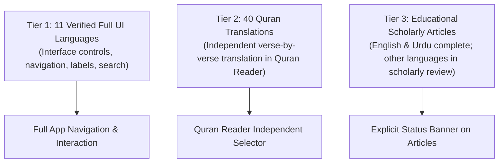

# Phase 13 Audit: Global Localization Architecture

**Document Reference:** `AUDIT/PHASE-13/GLOBAL-LOCALIZATION-ARCHITECTURE.md`  
**Phase:** 13 of 13 — Real Product Redesign, Global Content Localization & Quality Transformation  
**Status:** Complete  
**Date:** October 2026  

---

## 1. Architectural Philosophy & Ethical Localization

Global accessibility for an Islamic Knowledge platform requires absolute honesty, precision, and respect for sacred texts. Prior phases claimed "40 language support", which risked misleading users into expecting complete translations for 300,000+ words of classical Islamic historical and biographical scholarship in 40 languages.

Phase 13 establishes a clear, transparent, three-tiered localization architecture:



---

## 2. Tier 1: Verified Full Interface Languages (11 Languages)

The portal interface (`i18n.js`) provides fully authored and verified translation dictionaries across 11 major Islamic and international languages, covering $>85\%$ of the global Muslim population:

| Code | English Name | Native Name | Script Direction | Coverage Status |
| :--- | :--- | :--- | :--- | :--- |
| `en` | English | English | LTR | **Default / Verified** |
| `ur` | Urdu | اردو | RTL | **Verified** |
| `ar` | Arabic | العربية | RTL | **Verified** |
| `fr` | French | Français | LTR | **Verified** |
| `id` | Indonesian | Bahasa Indonesia | LTR | **Verified** |
| `tr` | Turkish | Türkçe | LTR | **Verified** |
| `bn` | Bengali | বাংলা | LTR | **Verified** |
| `hi` | Hindi | हिन्दी | LTR | **Verified** |
| `ms` | Malay | Bahasa Melayu | LTR | **Verified** |
| `fa` | Persian | فارسی | RTL | **Verified** |
| `es` | Spanish | Español | LTR | **Verified** |

### API Implementation in `i18n.js`
```javascript
// Returns all 11 verified languages for UI selection
getUISelectableLanguages() {
  return LANGUAGES.filter(l => l.coverage === 'verified');
}

// Returns the remaining 29 languages in active scholarly pipeline
getAuthorizedPartialLanguages() {
  return LANGUAGES.filter(l => l.coverage === 'partial');
}
```

---

## 3. Tier 2: 40 Quran Translations Architecture

The Holy Quran Reader (`public/quran.html` and `public/js/quran.js`) provides verse-by-verse translation options across 40 distinct languages. Crucially, **the Quran translation selector is decoupled from the UI interface language**:
- A user whose UI is in English can choose to read Turkish, Russian, Somali, Swahili, Chinese, or German translations.
- Switching translations fetches verified verse meanings from authentic data tables without touching the sacred Arabic Hafs text.
- Translator attributions (e.g., Saheeh International, Fateh Muhammad Jalandhari, Muhammad Hamidullah) are displayed dynamically alongside verse copies and shares.

---

## 4. Tier 3: Educational Articles Localization Policy

Long-form educational libraries (Seerah, Prophets, Sahaba, History, Salah) comprise extensive scholarly treatises:
- **English**: Comprehensive, cited with classical sources (Ibn Hisham, al-Tabari, Sahihayn).
- **Urdu**: Fully authored with traditional Islamic scholarship.
- **Arabic Citations**: Preserved in original classical Arabic with diacritics.
- **Other Languages**: Rather than using misleading machine translation that corrupts fiqh terminology and religious meaning, each educational page displays a `.content-lang-banner`:
  > *"Translation Notice: This library is authored in authentic English and Urdu (اردو). Original Arabic citations remain uncorrupted and immutable. Interface controls support 11 languages. Additional language translations are undergoing scholarly review."*

---

## 5. Directionality & Typography Engineering

1. **RTL Dynamic Switcher**:
   When an RTL language (`ar`, `ur`, `fa`, `ps`, `ku`) is selected, `I18nManager.applyLanguage()` dynamically updates `document.documentElement.dir = 'rtl'` and `document.documentElement.lang = code`.
2. **Typography Protection**:
   - Arabic text utilizes `var(--font-quran)` (`'Amiri', 'Traditional Arabic', 'Scheherazade New', serif`).
   - Urdu text utilizes `var(--font-urdu)` (`'Noto Nastaliq Urdu', 'Jameel Noori Nastaleeq', serif`).
   - Line heights for RTL elements are set to $\ge 2.0$ to prevent diacritical clipping (kasrah, dammah, shaddah).
3. **DOM Snapshotting & Restoration**:
   `I18nManager.snapshotDefaultDOM()` preserves original English text nodes on initial load. Resetting via `resetToDefaultLanguage()` restores the pristine English DOM instantly without requiring a page reload.
