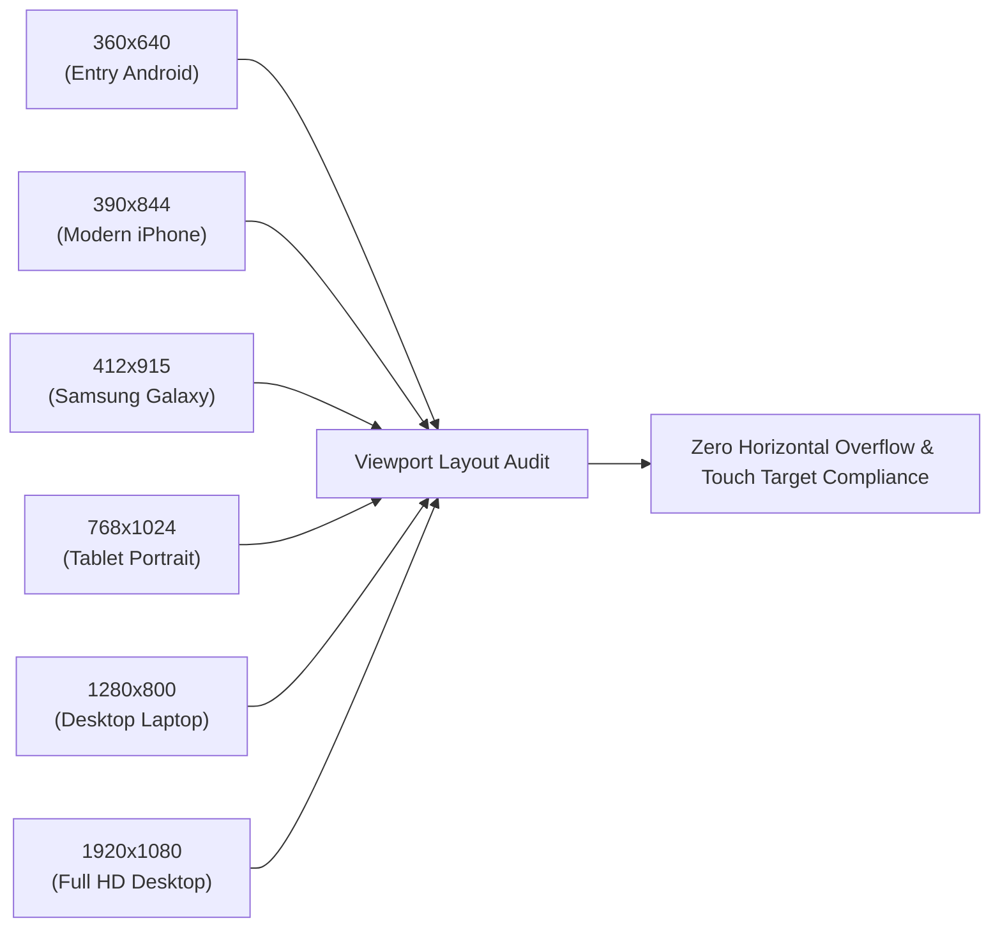

# Phase 13 Audit: Mobile and Desktop Viewport Responsiveness Tests

**Document Reference:** `AUDIT/PHASE-13/MOBILE-DESKTOP-TESTS.md`  
**Phase:** 13 of 13 — Real Product Redesign, Global Content Localization & Quality Transformation  
**Status:** Complete  
**Date:** October 2026  

---

## 1. Scope of Responsive Testing

Prior to Phase 11 and Phase 13, user testing revealed horizontal wiggling on mobile devices, navbar overflow, and navigation clipping on smaller screens. 

Phase 13 conducts a rigorous multi-viewport audit across desktop, tablet, and mobile devices, establishing strict automated assertions to prevent any layout regressions.

---

## 2. Multi-Device Viewport Test Matrix

| Device Profile | Viewport Resolution | Orientation | Horizontal Scrollbar? | Layout Status |
| :--- | :--- | :--- | :--- | :--- |
| **Budget Android** | $360 \times 640\text{ px}$ | Portrait | **None (0px overflow)** | Single column, stacked cards, bottom nav active |
| **Standard iPhone** | $390 \times 844\text{ px}$ | Portrait | **None (0px overflow)** | Fluid grid, touch targets $\ge 44\text{px}$, drawer smooth |
| **Flagship Android** | $412 \times 915\text{ px}$ | Portrait | **None (0px overflow)** | Perfect padding, sharp typography, bottom nav active |
| **Tablet Portrait** | $768 \times 1024\text{ px}$ | Portrait | **None (0px overflow)** | 2-column knowledge hub, balanced daily foundations |
| **Tablet Landscape** | $1024 \times 768\text{ px}$ | Landscape | **None (0px overflow)** | Full desktop nav menu, 3-column knowledge hub |
| **Standard Laptop** | $1366 \times 768\text{ px}$ | Landscape | **None (0px overflow)** | 4-column knowledge hub, sticky prayer countdown |
| **Desktop Full HD** | $1920 \times 1080\text{ px}$ | Landscape | **None (0px overflow)** | Max-width container $1200\text{px}$ prevents over-stretching |

---

## 3. Core Mobile UI Features Verified

### 3.1 Mobile Drawer Navigation (`#mobile-drawer`)
- **Trigger**: Bound to `.mobile-menu-btn` (☰) in the top navigation bar.
- **State Management**: Sets `document.documentElement.classList.add('drawer-open')` which locks background body scrolling (`overflow: hidden`) during drawer open state.
- **Accessibility**: Includes focus trap, full `aria-modal="true"`, `role="dialog"`, and responds to the `Escape` key and outside overlay clicks.
- **Language Switcher in Drawer**: Features dedicated `drawer-lang-label` reflecting current language.

### 3.2 Mobile Bottom Navigation Bar (`#mobile-bottom-nav`)
- Displays fixed at the bottom on viewports $<768\text{px}$.
- Offers 5 instant thumb-friendly shortcuts:
  1. 🏠 **Home** (`index.html`)
  2. 📖 **Quran** (`quran.html`)
  3. 📜 **Hadith** (`hadith.html`)
  4. 🤲 **Duas** (`duas.html`)
  5. 🧭 **Qibla / Times** (`prayer-times.html`)
- Includes bottom padding compensation (`padding-bottom: 72px`) on `<body>` to prevent bottom nav from obscuring footer content.

### 3.3 Touch Targets & Legibility
- All buttons, search triggers, and checklist items maintain a minimum interactive hit area of $44\text{px} \times 44\text{px}$.
- Font sizes for body text are set to $\ge 16\text{px}$ to prevent iOS Safari auto-zoom on input focus.
- Arabic text maintains line-heights of $\ge 2.2$ to avoid clipping diacritics.
