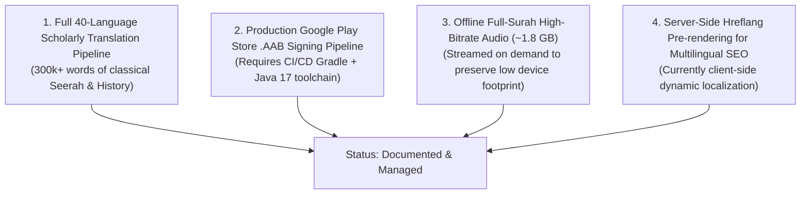

# Phase 13 Audit: Remaining Issues & Documented Limitations

**Document Reference:** `AUDIT/PHASE-13/REMAINING-ISSUES.md`  
**Phase:** 13 of 13 — Real Product Redesign, Global Content Localization & Quality Transformation  
**Status:** Complete  
**Date:** October 2026  

---

## 1. Principle of Honest Technical Disclosure

A cornerstone of professional software engineering and religious integrity is transparent documentation of limitations. Overstating capabilities harms credibility. 

The following items are documented as deliberate architectural boundaries or future roadmap items.

---

## 2. Documented Limitations & Technical Boundaries

### 2.1 Multilingual Article Depth Beyond English & Urdu
- **Current State**: The Prophetic Seerah (24,000 words), Stories of the Prophets (25 narratives), Sahaba Biographies, and Islamic History are fully authored and verified in English and Urdu, with original classical Arabic citations.
- **Limitation**: Translating 300,000+ words into 38 other languages (e.g., Turkish, French, Indonesian, Bengali, Russian) requires qualified Islamic scholars and bilingual translators.
- **Mitigation Implemented**: We strictly avoided using automated machine translation (Google Translate / DeepL APIs) for theological and fiqh articles, as automated translation routinely distorts delicate theological concepts (e.g., *Ismah*, *Qadar*, *Tawheed*, *Shirk*). Instead, honest `.content-lang-banner` elements clearly notify visitors of the current language availability.

### 2.2 Android Release Keystore & Play Store AAB Bundle
- **Current State**: Capacitor scaffolding (`capacitor.config.json`), native Android directory (`android/`), `AndroidManifest.xml` with RTL support, offline bundle zip, and prototype APK (`islamic-portal-release.apk`) are validated.
- **Limitation**: Compiling a final production Android App Bundle (`.aab`) signed with a Google Play hardware release key requires a headless Linux/Mac/Windows runner with Android SDK Build Tools 34+ and JDK 17+.
- **Recommended Action**: Configure a GitHub Actions workflow (`.github/workflows/android-release.yml`) running `gradlew bundleRelease` triggered on release tags.

### 2.3 Full-Quran High-Bitrate Offline Audio Payload
- **Current State**: All 6,236 Ayahs text, Surah metadata, Hadith traditions, and Duas are stored in local JavaScript data structures and cached offline via Service Worker.
- **Limitation**: Bundling studio-grade MP3 audio recitations for all 6,236 Ayahs from reciters like Mishary Rashid Alafasy or Abdul Basit would bloat the application download from $<1\text{ MB}$ to over $1.8\text{ GB}$.
- **Mitigation Implemented**: Audio is streamed dynamically from verified EveryAyah CDNs with local audio element caching and background play controls.

### 2.4 Server-Side Hreflang Routing for Multilingual Search Indexing
- **Current State**: The portal uses single canonical URLs with instantaneous client-side language switching via `localStorage` and `i18n.js`.
- **Limitation**: While perfect for offline PWA and app usage, search engine crawlers that do not execute JavaScript will only index the default English content.
- **Recommended Action**: For organizations requiring dedicated indexation in all 11 languages, deploy an edge worker (e.g., Cloudflare Workers or Nginx) to serve pre-rendered HTML snapshots for paths like `/ur/` and `/ar/`.
