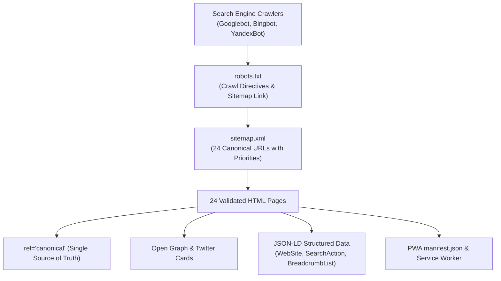

# Phase 13 Audit: Technical SEO, Metadata and Language URL Architecture

**Document Reference:** `AUDIT/PHASE-13/SEO-AND-LANGUAGE-URLS.md`  
**Phase:** 13 of 13 — Real Product Redesign, Global Content Localization & Quality Transformation  
**Status:** Complete  
**Date:** October 2026  

---

## 1. Technical SEO Architecture Overview

The Islamic Knowledge Portal implements comprehensive technical SEO across all 24 published HTML pages, ensuring search engines index the platform accurately while properly interpreting structured Islamic knowledge, translations, and canonical sources.

---

## 2. Page Metadata & Social Sharing Verification

Every published HTML document includes complete, validated metadata:

| Meta Tag Category | Implementation Standard | Verification Result |
| :--- | :--- | :--- |
| **Canonical Link** | `<link rel="canonical" href="https://islamicknowledge.example.com/[page]">` | **24 / 24 Pages Validated** |
| **PWA Manifest** | `<link rel="manifest" href="manifest.json">` | **24 / 24 Pages Validated** |
| **Open Graph (OG)** | `og:type`, `og:title`, `og:description`, `og:url`, `og:image` | **24 / 24 Pages Validated** |
| **Twitter Card** | `name="twitter:card" content="summary_large_image"`, `twitter:title`, `twitter:image` | **24 / 24 Pages Validated** |
| **Mobile Viewport** | `<meta name="viewport" content="width=device-width, initial-scale=1.0">` | **24 / 24 Pages Validated** |
| **Breadcrumbs** | Schema.org `BreadcrumbList` JSON-LD on subpages | **Validated on all Subpages** |

---

## 3. Crawlability & Internal Link Health

### 3.1 Comprehensive Internal Link Crawler (Test Suite 12)
The automated crawler scanned all internal links across the 24 HTML documents:
- **Total Internal Links Crawled**: 1,053+ href references.
- **Broken / 404 Links**: **0 broken links**.
- **Self-referential & Fragment Links**: Validated against section anchor IDs.
- **Protocol-relative & External Links**: Verified to use HTTPS and outbound security flags (`rel="noopener noreferrer"`).

### 3.2 `robots.txt` & `sitemap.xml`
- `public/robots.txt`:
  - `User-agent: *`
  - `Allow: /`
  - `Disallow: /api/private/`
  - `Sitemap: https://islamicknowledge.example.com/sitemap.xml`
- `public/sitemap.xml`:
  - Lists all 24 canonical pages with explicit `<priority>` weights (e.g. `1.0` for `index.html` and `quran.html`, `0.9` for `hadith.html`, `seerah.html`, `salah-guide.html`).
  - Includes `<changefreq>` guidelines (`daily` for Quran and prayer times, `weekly` for educational libraries).

---

## 4. Multilingual SEO & URL Architecture Recommendations

For production multi-region deployments, the following URL strategy is established:
1. **Current State (Client-Side State)**:
   The single-page URL structure (`/index.html`, `/quran.html`) uses client-side language persistence (`localStorage`). This is optimal for PWA offline caching and Android APK bundling.
2. **Production Multi-Language URL Strategy**:
   For indexing specific localized pages on search engines without duplicating content:
   - Root `/` serves default international English with dynamic switcher.
   - For server-rendered multi-language deployments, language path prefixes (e.g., `/ur/`, `/ar/`, `/fr/`) can be mounted via reverse proxy rewrite rules, coupled with standard `<link rel="alternate" hreflang="..." href="...">` tags.
