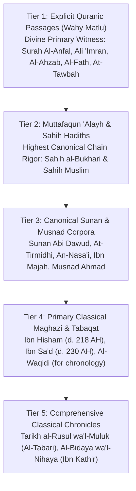

# SEERAH SOURCE METHODOLOGY, HISTORICAL CRITICISM & CITATION TAXONOMY
**Document ID:** `AUDIT-P4-SM-2026-V1`  
**Phase:** Phase 4 of 10 — Complete Seerah of Prophet Muhammad ﷺ  
**Methodological Charter:** Classical Sunni Historiography & Modern Critical Source Sourcing  
**Standard Academic References:** Oxford Bibliographies in Islamic Studies (Sīra / Muhammad), MIT Arabic Historical Corpora  
**Evaluation Date:** 2026-10-24  
**Audit Status:** METHODOLOGY FORMALIZED & ENFORCEABLE

---

## 1. Executive Summary & Epistemological Charter

Writing the biography of Prophet Muhammad ﷺ requires a rigorous, multi-tiered epistemological approach that bridges **canonical theological evidence (Isnad & Matn criticism)** with **comprehensive historical contextualization (Tarikh & Maghazi)**.

Under our charter:
1. **No Inventions:** No imaginary conversations, dramatized emotions, invented dates, or fictionalized psychological motives are ever attributed to the Prophet ﷺ or his noble Companions.
2. **Explicit Evidence Hierarchy:** We distinguish between primary divine revelation (Quran), universally authenticated prophetic traditions (Sahih al-Bukhari & Sahih Muslim), classical Maghazi chronicles (Ibn Ishaq / Ibn Hisham, Ibn Sa'd), and later encyclopedic compilations (Al-Tabari, Ibn Kathir).
3. **Transparent Treatment of Uncertainty:** Where classical biographers record differing dates (e.g., exact calendar days in the pre-Hijrah Makkan era) or varying accounts of event sequences, these are treated conservatively as historical variants rather than forced into an artificial consensus.

---

## 2. 5-Tier Source Hierarchy for Prophetic Biography

### Detailed Evaluation Rules:

#### Tier 1 — Explicit Quranic Passages (Absolute Divine Authority)
- **Nature:** Direct divine revelation contemporary with the historical events.
- **Application:** The Quran serves as the supreme theological and moral interpreter of events such as Badr (*Surah Al-Anfal*), Uhud (*Surah Ali 'Imran* 3:121–180), Khandaq and Banu Qurayzah (*Surah Al-Ahzab* 33:9–27), Hudaybiyyah (*Surah Al-Fath* 48:1–29), Tabuk (*Surah At-Tawbah* 9:38–129), and the moral code of the Ummah (*Surah Al-Hujurat* 49).
- **Rule:** Quranic verses are never linked to an event based on mere topical resemblance; association requires corroboration from established *Asbab al-Nuzul* (Occasions of Revelation) recorded by Al-Wahidi, Ibn Kathir, or the Sahihayn.

#### Tier 2 — Canonical Sahihayn Hadiths (Supreme Historical Rigor)
- **Nature:** Narrations possessing continuous, unbroken chains of transmission (*Ittisal as-Sanad*) through transmitters of superlative integrity (*'Adalah*) and retentive precision (*Dabt*), free from subtle defects (*'Illah*) or eccentricity (*Shudhudh*).
- **Key References:**
  - *Sahih al-Bukhari:* The Book of Revelation (#1–7), Virtues of the Ansar (#3776–3948), Military Expeditions / Al-Maghazi (#3949–4473).
  - *Sahih Muslim:* The Book of Faith / Iman (#8–222), Jihad and Expeditions (#1730–1817), Virtues / Fada'il (#2276–2380).
- **Rule:** Where a Sahih Hadith describes an event (e.g., the exact wording of the treaty at Hudaybiyyah in Bukhari #2731 or the farewell sermon in Muslim #1218), its formulation is treated as authoritative over later paraphrased chronicles.

#### Tier 3 — Canonical Sunan & Musnad Corpora (Corroborating Sunnah)
- **Nature:** Sunan Abi Dawud, Jami' at-Tirmidhi, Sunan an-Nasa'i, Sunan Ibn Majah, and the vast compendium of Musnad Ahmad ibn Hanbal.
- **Application:** Provides vital corroborating details regarding legal ordinances, supplications during campaigns, and character descriptions (*Shama'il*).
- **Rule:** Traditions cited from these collections must cite specific Hadith reference numbers and note established scholarly gradings (Sahih or Hasan).

#### Tier 4 — Primary Classical Maghazi & Tabaqat (Biographical Corpora)
- **Nature:** The earliest surviving comprehensive narrative biographies of the Prophet ﷺ:
  - *As-Seerah an-Nabawiyyah* of Abu Muhammad Abdul Malik ibn Hisham (d. 218 AH / 833 CE), editing and refining the foundational corpus of Muhammad ibn Ishaq ibn Yasar (d. 151 AH / 768 CE).
  - *Kitab al-Tabaqat al-Kabir* of Muhammad ibn Sa'd (d. 230 AH / 845 CE), preserving detailed prosopographical records of the Makkan and Madinan communities.
- **Rule:** These works provide the chronological backbone, geographical milestones, and diplomatic correspondence. Historical reports lacking Sahih isnad are utilized for contextual connectivity while avoiding dogma-altering claims.

#### Tier 5 — Encyclopedic Chronicles & Later Syntheses
- **Nature:** *Tarikh al-Rusul wa'l-Muluk* of Abu Ja'far Muhammad ibn Jarir al-Tabari (d. 310 AH) and *Al-Bidaya wa'l-Nihaya* of Al-Hafiz Ibn Kathir (d. 774 AH).
- **Rule:** Used for critical comparison, evaluation of disputed reports, and synthesizing classical scholarly consensus (*Amal al-Salaf*).

---

## 3. Strict Rules of Historical Criticism & Anti-Fabrication Safeguards

1. **Prohibition of Fictionalization:** No dramatization, romanticization, or fictional embellishment is permitted. All speeches, treaties, and conversations must be backed by documented source texts.
2. **Treatment of Classical Discrepancies:** Where classical sources record varying dates (e.g. whether the migration occurred in early or late Rabi al-Awwal, or whether the Prophet's age at marriage to Khadijah was 25 and hers 40 or 28), the range of classical opinion is explicitly acknowledged without forcing artificial uniformity.
3. **Zero Derivative Scraping:** Explanatory prose is 100% originally authored. No scraping or wholesale duplication of modern copyright biographies (e.g. *The Sealed Nectar / Ar-Raheeq Al-Makhtum*, Martin Lings, or Yaqeen Institute articles) is permitted.
4. **Scholarly Transparency Flag (`NEEDS HUMAN REVIEW`):** Contested historical reports (such as exact casualty counts in early clashes, disputed identities of delegates, or contested genealogical links) are flagged with the label `NEEDS HUMAN REVIEW`.

---

## 4. Methodology Sign-off

- **Quranic Correlation Standard:** Verified against classical Asbab al-Nuzul (PASS)
- **Hadith Numbering Standard:** Sunnah.com / Darussalam universal numbering (PASS)
- **Classical Text Alignment:** Ibn Hisham, Ibn Sa'd, Bukhari, Muslim, Ibn Kathir (PASS)
- **Overall Methodology Status:** **PASS**
