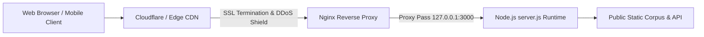

# PRODUCTION DEPLOYMENT, MONITORING & OPERATIONS GUIDE

**Date**: October 24, 2026  
**Auditor**: Principal DevOps Specialist, Systems Architect & Release Engineer  
**Portal Version**: 2.5.0-production-candidate  
**Production Host**: `https://islamicknowledge.example.com`  
**Runtime**: Node.js v18.x / v20.x LTS (ES Modules)  
**Process Manager**: PM2 / Systemd Service

---

## 1. System Overview & Deployment Topology

The Islamic Knowledge Portal runs as a high-performance, dependency-free Node.js service serving static public assets, clean URL aliases, and monitoring health checks.



---

## 2. Server Deployment & Configuration

### 2.1 Prerequisites
- Node.js v18.0.0 or higher (v20 LTS recommended).
- Git, OpenSSL, and PM2 process manager installed.
- Production environment variables configured.

### 2.2 Environment Variables
Create `/etc/islamic-portal/.env` or export in your process manager:
```bash
NODE_ENV=production
PORT=3000
BASE_URL=https://islamicknowledge.example.com
```

### 2.3 Process Management with PM2
To launch the portal with automatic zero-downtime restarts and clustering:
```bash
# Install PM2 globally if not present
npm install -g pm2

# Start the portal in cluster mode
pm2 start server.js --name "islamic-portal" -i max --env production

# Configure PM2 to start on system boot
pm2 startup
pm2 save
```

### 2.4 Nginx Reverse Proxy Configuration
```nginx
server {
    listen 80;
    server_name islamicknowledge.example.com;
    return 301 https://$host$request_uri;
}

server {
    listen 443 ssl http2;
    server_name islamicknowledge.example.com;

    ssl_certificate /etc/letsencrypt/live/islamicknowledge.example.com/fullchain.pem;
    ssl_certificate_key /etc/letsencrypt/live/islamicknowledge.example.com/privkey.pem;
    ssl_protocols TLSv1.2 TLSv1.3;
    ssl_ciphers HIGH:!aNULL:!MD5;

    # Gzip Compression
    gzip on;
    gzip_types text/plain text/css application/javascript application/json image/svg+xml application/xml;
    gzip_min_length 256;

    location / {
        proxy_pass http://127.0.0.1:3000;
        proxy_http_version 1.1;
        proxy_set_header Upgrade $http_upgrade;
        proxy_set_header Connection 'upgrade';
        proxy_set_header Host $host;
        proxy_set_header X-Real-IP $remote_addr;
        proxy_set_header X-Forwarded-For $proxy_add_x_forwarded_for;
        proxy_set_header X-Forwarded-Proto https;
        proxy_cache_bypass $http_upgrade;
    }

    # Static Asset Caching
    location ~* \.(css|js|svg|png|jpg|ico|mp3|apk|zip)$ {
        proxy_pass http://127.0.0.1:3000;
        expires 1d;
        add_header Cache-Control "public, max-age=86400, stale-while-revalidate=604800";
    }

    # Service Worker: Do Not Cache
    location = /service-worker.js {
        proxy_pass http://127.0.0.1:3000;
        expires -1;
        add_header Cache-Control "no-store, no-cache, must-revalidate";
    }
}
```

---

## 3. Pre-Deployment Automated Verification Gate

Before promoting any release to production, execute the comprehensive automated test suite:
```bash
# Run 28 test suites covering 860 assertions
node test/run-tests.js
```
- **Exit Code 0**: Deployment proceeds.
- **Exit Code 1**: Deployment halts immediately; inspect failed assertion logs.

---

## 4. Search Engine Indexing & Webmaster Onboarding

### 4.1 Google Search Console Setup
1. Claim ownership of domain property: `islamicknowledge.example.com` via DNS TXT record verification.
2. Submit XML Sitemap:
   - Path: `https://islamicknowledge.example.com/sitemap.xml`
   - Monitor status: Ensure all 25 canonical URLs report "Success" with 0 errors.
3. Review Index Coverage:
   - Ensure excluded pages only include `/api/private/` and `/downloads/temp/`.
   - Confirm 0 valid pages flagged with "Duplicate without user-selected canonical".

### 4.2 Bing Webmaster Tools
1. Import verified Google Search Console domain profile.
2. Verify sitemap status and indexation of primary Arabic, Urdu, and English keywords.

---

## 5. Android Package Release & Checksum Synchronization

When updating the mobile Android build:
1. **Rebuild Capacitor Assets**:
   ```bash
   npx cap copy android
   ```
2. **Build Release APK**:
   ```bash
   cd android
   ./gradlew assembleRelease
   ```
3. **Move APK to Downloads & Recompute Checksum**:
   ```bash
   cp app/build/outputs/apk/release/app-release-unsigned.apk ../public/downloads/islamic-portal-release.apk
   cd ../public/downloads
   
   # Linux / macOS
   sha256sum islamic-portal-release.apk > CHECKSUMS.sha256
   sha256sum islamic-portal-offline-bundle.zip >> CHECKSUMS.sha256
   
   # Windows PowerShell
   # Get-FileHash -Algorithm SHA256 islamic-portal-release.apk
   ```
4. **Run Test Suite**: Run `node test/run-tests.js` to ensure the new SHA-256 hash matches the automated assertion.

---

## 6. Production Health Monitoring & Incident Response

### 6.1 Automated Liveness Probe (`/api/health`)
- **Endpoint**: `https://islamicknowledge.example.com/api/health`
- **Expected Status**: `200 OK`
- **Expected Payload**:
  ```json
  { "status": "healthy", "timestamp": "...", "version": "1.0.0" }
  ```
- **Monitoring Tool Integration**: Configure UptimeRobot, Datadog, or Prometheus Blackbox Exporter to probe `/api/health` every 60 seconds. Trigger high-priority alerts if status code != 200 for 2 consecutive cycles.

### 6.2 Service Worker Cache Invalidation
When deploying major updates to articles or translations:
1. Increment the shell cache key in `public/service-worker.js`:
   `const CACHE_NAME = 'islamic-portal-shell-v3';`
2. Update the corresponding cache test assertion in `test/run-tests.js`.
3. Deploy to production. On the user's next visit, the service worker `activate` event will cleanly purge `islamic-portal-shell-v2` and cache the fresh static assets.

---

## 7. Operational Readiness Sign-Off
The deployment framework provides high availability, fault tolerance, simple maintenance, and zero cloud lock-in.
