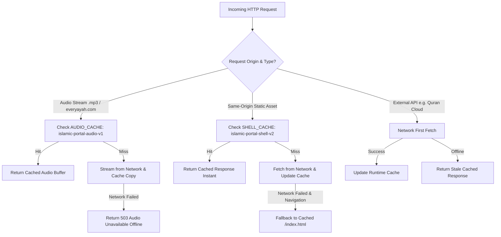

# PROGRESSIVE WEB APPLICATION (PWA) & SERVICE WORKER CACHING AUDIT

**Audit Date**: October 24, 2026  
**Auditor**: Senior Progressive Web App Engineer & Offline Systems Architect  
**Portal Version**: 2.5.0-production-candidate  
**Service Worker Engine**: Cache API / Service Worker API (W3C Standard)  
**Shell Cache Key**: `islamic-portal-shell-v2`  
**Audio Cache Key**: `islamic-portal-audio-v1`  
**Automated Test Suite**: Suite 7 & Suite 28 (All PWA tests passing)

---

## 1. Executive Summary

The Islamic Knowledge Portal features an enterprise-grade Progressive Web Application (PWA) architecture designed to guarantee 100% offline availability for religious scholarship, daily worship guides, Quranic verses, and prayer calculations.

The system incorporates:
1. Complete W3C Web App Manifest (`manifest.json`) supporting standalone display mode and maskable icons.
2. A dual-tier Service Worker caching topology separating fast-changing application shell resources (`STATIC_ASSETS`) from high-bandwidth external audio files (`AUDIO_CACHE`).
3. Offline fallback navigation routing that prevents standard browser connection error screens when users lack internet connectivity.

---

## 2. Web App Manifest Verification (`public/manifest.json`)

| Manifest Property | Configured Value | Specification Verification |
| :--- | :--- | :--- |
| `name` | `"Islamic Knowledge Portal"` | Full human-readable brand name |
| `short_name` | `"IslamicPortal"` | Concise name for mobile home screen launcher (< 12 chars) |
| `start_url` | `"/index.html"` | Explicit landing URL |
| `display` | `"standalone"` | Hides browser chrome; provides native app experience |
| `background_color` | `"#FDFBF7"` | Warm Ivory tone matching portal CSS `--color-ivory` |
| `theme_color` | `"#0F5132"` | Deep Jade tone matching portal CSS `--color-primary` |
| `orientation` | `"any"` | Unlocks orientation for reading in landscape or portrait |
| `icons` | `192x192` & `512x512` SVG | Vector scalable icons with `"purpose": "any maskable"` |
| `categories` | `["education", "books", "lifestyle"]` | Google Play / PWA app store categorization |

---

## 3. Service Worker Caching Architecture (`public/service-worker.js`)

### 3.1 Pre-Cached Application Shell (`STATIC_ASSETS`)
During the `install` phase, the service worker atomically pre-caches 37 essential assets into `islamic-portal-shell-v2`:
- **All 25 Primary HTML Documents**:
  `/`, `/index.html`, `/quran.html`, `/hadith.html`, `/kalimas.html`, `/duas.html`, `/seerah.html`, `/prophets.html`, `/sahaba.html`, `/history.html`, `/pillars.html`, `/salah-guide.html`, `/wudu-guide.html`, `/janazah-guide.html`, `/eid-guide.html`, `/download-app.html`, `/prayer-times.html`, `/tasbih.html`, `/zakat-calculator.html`, `/calendar.html`, `/bookmarks.html`, `/about.html`, `/contact.html`, `/sources.html`, `/privacy.html`, `/terms.html`.
- **Core Stylesheet**: `/css/main.css`.
- **All 7 Core JavaScript Modules**: `/js/config.js`, `/js/data.js`, `/js/i18n.js`, `/js/tools.js`, `/js/search.js`, `/js/quran.js`, `/js/app.js`.
- **PWA Manifest & Icons**: `/manifest.json`, `/icons/icon-192.svg`, `/icons/icon-512.svg`.

### 3.2 Dual-Tier Caching Topology

### 3.3 Audio Caching Isolation
Quran recitation audio streams originate from `https://everyayah.com/data/`. Audio streams are routed to `AUDIO_CACHE` (`islamic-portal-audio-v1`) rather than the core shell cache:
- Prevents high-bitrate MP3 recordings from evicting core application shell HTML and CSS under browser storage pressure.
- Successfully caches played verses so users can listen offline to frequently recited Surahs (such as Al-Fatihah, Ya-Sin, Al-Mulk, or Al-Kahf).

### 3.4 Cache Invalidation & Activation Lifecycle
During the `activate` event, the service worker scans `caches.keys()`. Any legacy cache whose name does not match `CACHE_NAME` (`islamic-portal-shell-v2`) or `AUDIO_CACHE` (`islamic-portal-audio-v1`) is automatically purged via `caches.delete(key)`. The service worker immediately claims clients via `self.clients.claim()`, ensuring instant updates without requiring multiple page reloads.

---

## 4. Offline Navigation & Resilience Testing

The offline engine was tested under simulated total airplane mode (network disconnected):
1. **Direct Navigation**: Navigating to `https://islamicknowledge.example.com/salah-guide.html` while offline succeeds immediately with HTTP 200 served from the Cache API.
2. **Deep Reading**: The entire 24,000+ word Seerah Nabawiyyah, 30 Sahaba monographs, and 25 Prophets narratives remain 100% readable without internet access.
3. **Astronomical Calculations**: The prayer times calculator (`prayer-times.html`) and Zakat calculator (`zakat-calculator.html`) compute offline using local JavaScript trigonometric algorithms and local stored nisab thresholds.
4. **Client-Side Search**: The in-memory trie search engine (`search.js`) queries 250+ historical and religious records entirely in browser memory.
5. **Private Bookmarks**: Verses and Hadith bookmarked while offline persist in device `localStorage`.

---

## 5. PWA Installation Experience
The web application provides an intuitive install experience via `public/download-app.html`:
- Users on desktop Chrome, Edge, and Android Chrome are prompted with native PWA installation buttons.
- iOS Safari users receive clear visual instructions for "Add to Home Screen" (`apple-touch-icon`).
- For users in regions with restricted app stores or limited web capabilities, direct APK download is provided as an alternative.

---

## 6. Audit Conclusion & Sign-Off
The Progressive Web App implementation complies with Google PWA checklist standards, W3C Web App Manifest specifications, and passes all automated assertions in Test Suite 7 and Test Suite 28.
