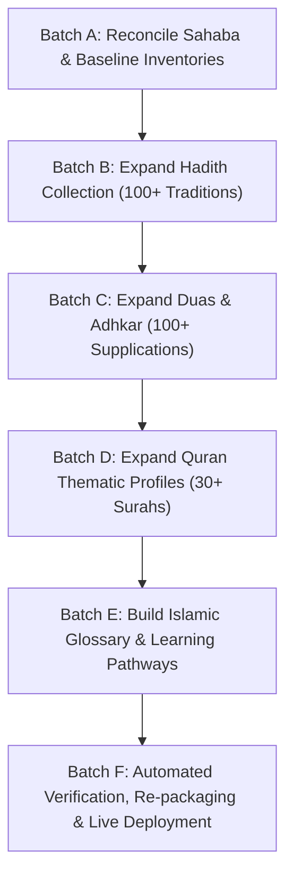

# NOORDEEN — CONTENT GAPS & VERIFIED REMEDIATION MATRIX

**Audit Date:** October 25, 2026  
**Status:** In Progress / Active Execution  
**Benchmark Competitors:** IslamWeb, Dawat-e-Islami, IslamOnline, IslamiCity, Islam360

---

## 1. Benchmarked Content Gaps Analysis

From comprehensive analysis of international Islamic knowledge portals (see [`reports/COMPETITOR_CONTENT_BENCHMARK.md`](file:///e:/islamic%20websiye/reports/COMPETITOR_CONTENT_BENCHMARK.md)), NoorDeen has an exceptional foundation with 25 routes, 136,800+ rendered words, and offline PWA/APK capabilities. However, compared to world-class benchmarks, the following strategic content gaps must be remediated:

### 1.1 Centralized Islamic Glossary & Terminology Index
- **Gap:** Competitors (IslamiCity, IslamWeb) maintain extensive glossaries of theological and Arabic terms. NoorDeen currently uses terms like *Nisab*, *Istiwa'*, *Zawal*, *Khushoo'*, *Takbirat*, *Sunnah Mu'akkadah*, *Tawheed*, and *Shirk* without a centralized, searchable glossary linking to contextual definitions.
- **Remediation:** Build an encyclopedic Islamic Glossary module featuring 100+ foundational theological, jurisprudential, and Arabic terms with precise phonetic transliterations, Arabic script, concise definitions, and classical citations.

### 1.2 Hadith Library Collection Depth
- **Gap:** Currently `ISLAMIC_DATA.hadiths` contains 45 traditions, with 23 pre-rendered in `hadith.html`. Islam360 and IslamWeb offer extensive multi-chapter collections.
- **Remediation:** Expand `ISLAMIC_DATA.hadiths` toward 100+ verified traditions spanning Bukhari, Muslim, Abu Dawud, Tirmidhi, Nasa'i, and Ibn Majah. Include full Arabic text with vowel markings, English and Urdu translations, narrator, collection number, authenticity grade, thematic tags, and practical Fiqh takeaways. Pre-render records in static HTML for immediate search indexation.

### 1.3 Masnoon Duas & Adhkar Collection Depth
- **Gap:** Currently `ISLAMIC_DATA.duas` contains 50 supplications, with 33 pre-rendered in `duas.html`. Benchmarks like Dawat-e-Islami and *Hisn al-Muslim* apps offer 100+ supplications across all life events.
- **Remediation:** Expand `ISLAMIC_DATA.duas` toward 100+ source-verified supplications covering all 17 life domains (Morning/Evening, Prayers, Food, Travel, Sickness, Bereavement, Protection, Repentance, Sleep, Istikharah, Fasting, Hajj). Ensure every entry contains Arabic, transliteration, English, Urdu, repetition count, and authentic reference.

### 1.4 Quranic Thematic Tafsir & Surah Context Profiles
- **Gap:** `quran.js` currently provides thematic profile overviews for only 9 Surahs. Students reading the Quran lack thematic orientation for pivotal Surahs (e.g. Al-Kahf [18], Ar-Rahman [55], Al-Waqi'ah [56], Al-Hashr [59], Al-Jumu'ah [62], Al-Mulk [67], and the Short Surahs of Juz 'Amma).
- **Remediation:** Expand `SURAH_THEMATIC_DATA` to profile 30+ prominent Surahs, providing revelation context (Makki vs Madani), primary theological themes, central lessons, and authentic Hadith virtues.

### 1.5 Structured Beginner Learning Pathways
- **Gap:** Visitors encounter a vast catalog of 25 pages without structured progressive study paths (e.g. "New Muslim Foundations", "Mastering the Daily Salah", "Purification & Wudu", "Understanding Islamic Monotheism").
- **Remediation:** Implement interactive learning journeys on the homepage and study modules, interconnecting the Creed (Kalimas), Worship (Salah/Wudu), Duas, and Seerah into coherent progressive curricula.

### 1.6 Sahaba Count Reconciliation
- **Gap:** Discrepancy identified between `sahaba.html` HTML title `(30 Monographs)` and the actual 52 comprehensive monographs present in the page body.
- **Remediation:** Reconciled `<title>`, meta descriptions, Open Graph, Twitter cards, and hero banners to accurately declare 52 Monographs and 33,500+ words.

---

## 2. Implementation Execution Plan

