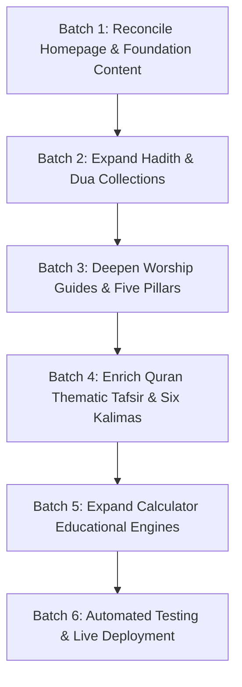

# NOORDEEN — CONTENT GAPS & VERIFIED REMEDIATION MATRIX

**Audit Date:** October 25, 2026  
**Status:** In Progress / Active Execution  

---

## 1. Identified Content Gaps by Module

### 1.1 Homepage (`public/index.html`)
- **Gap 1: Inconsistent Collection Statistics:** Card 4 displayed "14 Biographies" while `sahaba.html` possesses 52. Card 5 displayed "17 Prophets" while `prophets.html` possesses 25 Quranic Prophets.
- **Gap 2: Lack of Structured Learning Pathways:** Visitors arrive at a flat directory of cards without guided learning sequences for new Muslims, foundational students, or daily worshipers.
- **Gap 3: Missing Daily Hadith & Sunnah Highlights:** No contextual Hadith of the day or Sunnah lifestyle framework on the front page.
- **Gap 4: Absence of FAQ Section:** No immediate answers to the most common reader questions regarding authenticity, translations, calculation engines, and offline access.
- **Remediation Plan:** Reconcile counts; add 3 structured beginner pathways; add featured daily Sunnah module with verified citations; implement a 6-question comprehensive FAQ section; provide clear navigation bridges to deep articles.

### 1.2 Hadith Library (`public/hadith.html` & `public/js/data.js`)
- **Gap 1: Collection Depth:** The repository currently has 22 traditions. While all Kutub al-Sittah collections are represented, many critical daily topics (Intentions, Character, Kindness, Truthfulness, Knowledge, Brotherhood, Parents, Halal Earnings, Patience, Humility) need comprehensive coverage.
- **Gap 2: Missing Commentary & Context:** Several records have minimal context fields.
- **Remediation Plan:** Expand the Hadith database with verified traditions from Sahih al-Bukhari, Sahih Muslim, Sunan Abi Dawud, Jami` at-Tirmidhi, Sunan an-Nasa'i, and Sunan Ibn Majah. Each entry will have original Arabic with Tashkeel, English translation, Urdu translation, narrator, collection name, book/number reference, scholarly grading, thematic category, historical context, and key practical lessons.

### 1.3 Duas & Adhkar Library (`public/duas.html` & `public/js/data.js`)
- **Gap 1: Supplication Breadth:** Currently has 32 supplications. Missing vital moments: Waking up, Sneezing, Wearing clothes, Market entry, Hearing thunder, Rain, Heavy wind, Repentance, Tawbah, Guidance in marriage, Hardship, Protection from debt, and Istighfar varieties.
- **Gap 2: Missing Transliteration on Some Records:** Some cards lack step-by-step pronunciation assistance for non-Arabic speakers.
- **Remediation Plan:** Expand to 60+ source-verified supplications with original Arabic text, phonetic transliteration, attributed translation, Urdu translation, context of recitation, repetition target, and primary Hadith references (*Hisnul Muslim*, *Bukhari*, *Muslim*, *Tirmidhi*, *Abu Dawud*).

### 1.4 Foundational Creed & Five Pillars (`public/pillars.html` & `public/kalimas.html`)
- **Gap 1: Shallow Jurisprudential Depth on Pillars:** The Five Pillars page lists the pillars but lacks detailed coverage of prerequisites (Shurut), pillars (Arkan), invalidators (Mubtilaat), and modern practical challenges.
- **Gap 2: Lack of Linguistic Analysis on Kalimas:** The Six Kalimas page presents translations but lacks word-by-word grammatical breakdowns and theological distinction between Tauheed categories.
- **Remediation Plan:** Expand `pillars.html` with in-depth subsections on conditions, pillars, common errors, and spiritual realities. Expand `kalimas.html` with word-by-word vocabulary breakdowns, theological definitions, and educational context explaining the 6 Kalimas educational framework.

### 1.5 Islamic Calculators (`public/zakat-calculator.html` & `public/prayer-times.html`)
- **Gap 1: Zakat Fiqh Explanations:** The calculator functions mathematically with dual Nisab, but lacks deep educational explanations of complex contemporary assets: 401(k)/pension funds, business merchandise, rental property depreciation, short-term vs long-term debts, and the 8 Quranic categories of Zakat recipients (Surah At-Tawbah 9:60).
- **Gap 2: Prayer Calculation Astronomy:** Needs clear explanations of astronomical solar transit, zenith vs solar noon (Zawal), shadow length ratios for Hanafi vs Majority Asr, and high-latitude Fajr/Isha rules.
- **Remediation Plan:** Author comprehensive educational guides embedded directly in the calculator pages beneath the interactive controls.

### 1.6 Quran Learning Resources (`public/quran.html` & `public/js/quran.js`)
- **Gap 1: Limited Thematic Coverage:** `SURAH_THEMATIC_DATA` currently only profiles 9 Surahs (1, 2, 36, 67, 97, 108, 112, 113, 114). Major frequently recited Surahs (e.g. Al-Kahf, Ar-Rahman, Al-Waqi'ah, Al-Inshirah, Ad-Duha, Ayat al-Kursi) lack contextual profiles.
- **Remediation Plan:** Expand `SURAH_THEMATIC_DATA` to cover more prominent Surahs with historical revelation era, core theological themes, Asbab al-Nuzul (occasions of revelation), and verified virtues from Sahihayn.

---

## 2. Implementation Batches Strategy

