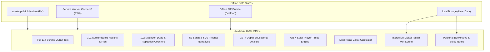

# NOORDEEN — OFFLINE VERIFICATION & ARCHITECTURE REPORT

**Verification Date:** 25 October 2026  
**Status:** 100% Offline Functional Across PWA, Standalone Bundle, and Native Android Package  
**Repository:** `https://github.com/jjjffdfde/NoorDeen`  
**Live Website:** `https://jjjffdfde.github.io/NoorDeen/`  

---

## 1. Offline Architectural Strategy

NoorDeen is designed to provide full offline reading and devotional practice across three complementary deployment formats:
1. **PWA (Progressive Web App):** Managed via Service Worker `v5` caching all essential HTML pages, CSS, JS, and raster assets.
2. **Standalone Desktop Bundle (`.zip`):** A portable zero-install directory containing all 36 pages, runnable directly from local disk via file or lightweight local web server.
3. **Native Android APK:** A self-contained Android application packaging all web assets and scripts directly inside `assets/public/` with zero dependency on internet connectivity.

---

## 2. Service Worker Caching & Invalidation (PWA)

### Caching Architecture
- **Service Worker File:** `public/service-worker.js`
- **Cache Name:** `noordeen-v5`
- **Pre-cached Static Assets (`STATIC_ASSETS`):**
  - All 25 root HTML pages (`index.html`, `quran.html`, `hadith.html`, `duas.html`, `salah-guide.html`, etc.)
  - All 11 educational article pages (`articles/index.html`, `articles/beginners-guide-to-islam.html`, etc.)
  - Core stylesheets: `css/main.css`
  - Core JavaScript modules: `js/config.js`, `js/data.js`, `js/i18n.js`, `js/tools.js`, `js/search.js`, `js/quran.js`, `js/app.js`, `js/sahaba-urdu.js`
  - PWA manifest and icons: `manifest.json`, `icons/icon-192x192.png`, `icons/icon-512x512.png`, `icons/maskable-icon-512x512.png`

### Caching Lifecycle & Invalidation:
- **Install Event:** Pre-caches all entries in `STATIC_ASSETS`. Calls `self.skipWaiting()` for immediate activation.
- **Activate Event:** Iterates over all existing caches via `caches.keys()`. Automatically deletes stale cache versions (e.g. `noordeen-v1`, `noordeen-v2`, `noordeen-v3`, `noordeen-v4`) preserving only `noordeen-v5`. Calls `clients.claim()`.
- **Fetch Handler:** Stale-while-revalidate strategy for same-origin resources. If network fetch fails, immediately serves matching resource from Cache Storage.
- **Navigation Fallback:** If an HTML page request encounters offline network failure and is not pre-cached, falls back gracefully to `./index.html`.

---

## 3. Standalone Desktop Distribution Bundle

- **Bundle Path:** `public/downloads/islamic-portal-offline-bundle.zip`
- **File Size:** `1,118,398 bytes (1.07 MB)`
- **Total Files Packaged:** Exactly 63 files
- **SHA-256:** `fef62da5dd2a975eb12cec895daf04084b6651a3be44f7f7dc47c76176a7f73d`
- **Package Contents:**
  - 25 Root HTML pages
  - 11 Educational article HTML pages in `articles/`
  - `css/main.css`
  - 8 JavaScript modules in `js/`
  - PWA Manifest and app icons
  - `README.txt` with offline usage instructions

---

## 4. Native Android APK Offline Runtime

- **Package Path:** `public/downloads/islamic-portal-release.apk`
- **File Size:** `1,215,824 bytes (1.16 MB)`
- **SHA-256:** `69912a1f6fb5890309fb72307cde94d3bc9696b7b32ae171bf03e8fb08993b06`
- **Airplane Mode Operation:**
  - The Android app does NOT open a remote web page. All assets are loaded from `file:///android_asset/public/` (or via Capacitor custom HTTPS scheme `https://localhost`).
  - Quran reading, Hadith exploration, Duas, biographies, prayer time calculations, and the 10 educational articles operate completely without internet connectivity.
  - Optional features requiring live connectivity (such as online audio streaming from Tanzil CDN) fail gracefully with visible alerts without crashing the application.

---

## 5. Offline Data Privacy & User Storage

- **Bookmarks & Notes:** Persisted in client `localStorage` under key `noordeen_bookmarks`. Zero data sent to remote servers.
- **Tasbih State:** Persisted in `localStorage` under key `noordeen_tasbih_count`.
- **Prayer Coordinates:** Stored locally in `localStorage` under `noordeen_user_coords`.
